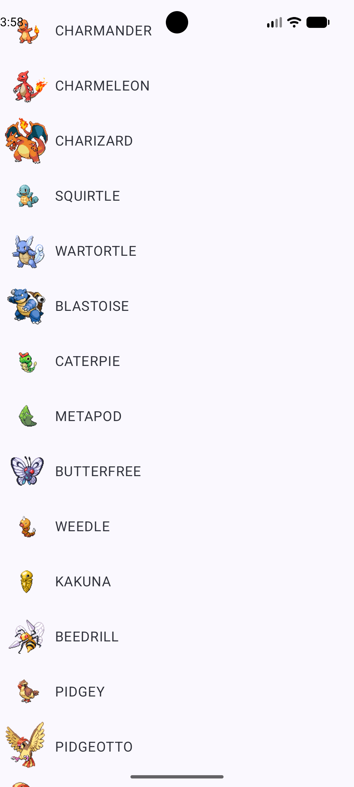
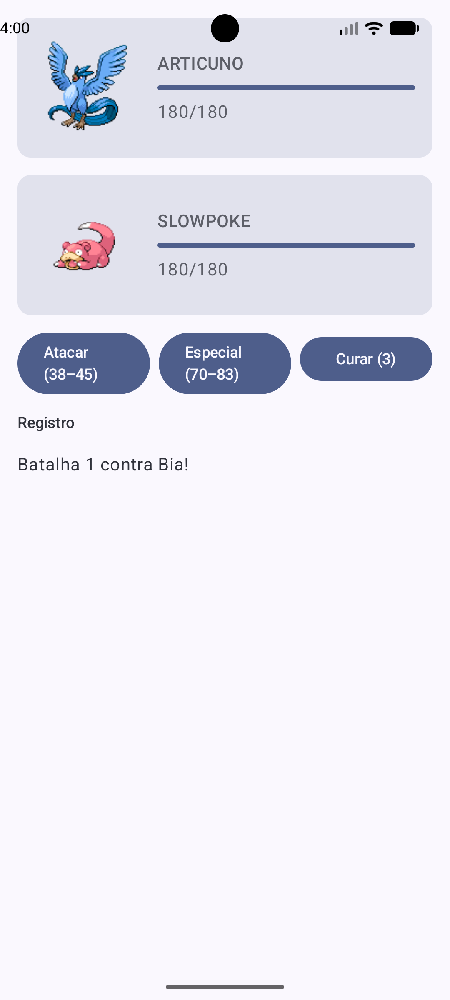
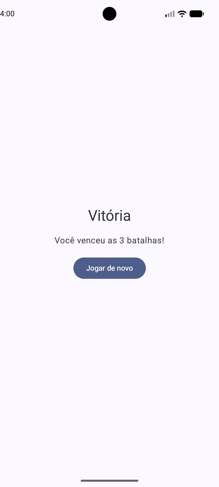
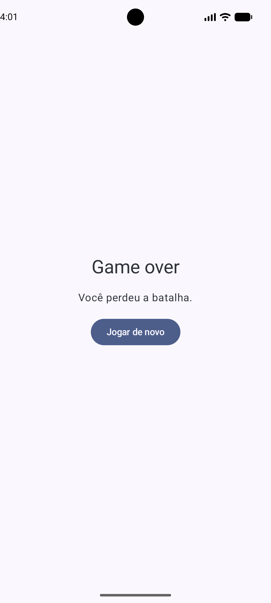
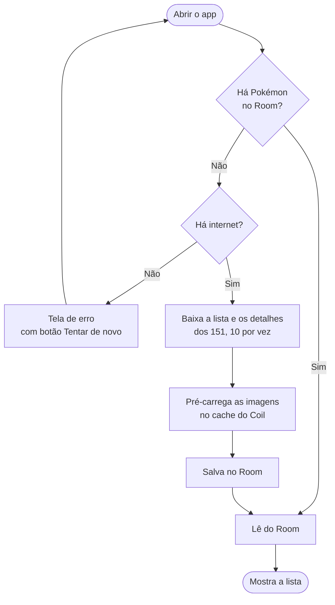
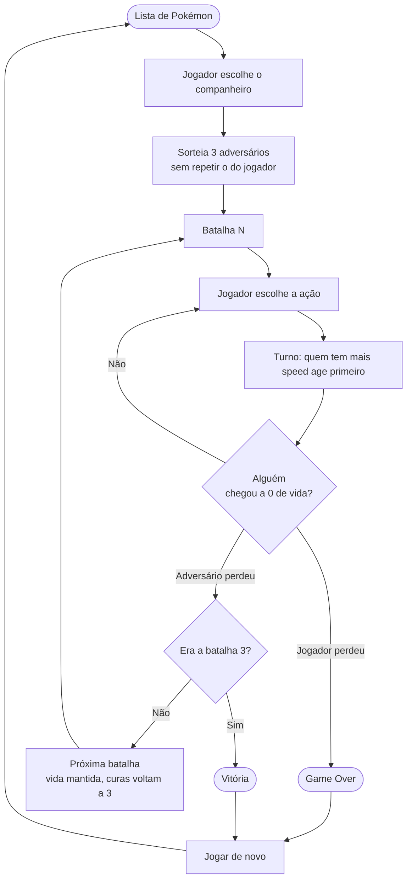

# App Pokémon

Aplicativo Android feito para um desafio técnico. O jogador escolhe um Pokémon entre os 151 primeiros, enfrenta três adversários e, se vencer os três, ganha o jogo. Se perder uma batalha, é Game Over. Em qualquer um dos casos dá para jogar de novo desde o início.

Os dados vêm da [PokeAPI](https://pokeapi.co/) só na primeira abertura. Depois disso o jogo funciona inteiro offline, inclusive as imagens.

**Baixar o APK:** [Releases](https://github.com/RicardoJuliano/app_pokemon/releases/latest)

## Telas

| Lista | Batalha | Vitória | Game Over |
|---|---|---|---|
|  |  |  |  |

## Como rodar

Você precisa do Android Studio e de um emulador ou aparelho com Android 7.1 (API 25) ou mais novo.

```
git clone https://github.com/RicardoJuliano/app_pokemon.git
```

1. Abra a pasta no Android Studio e espere o sync do Gradle terminar.
2. Escolha o emulador ou o aparelho e clique em Run.
3. Na primeira abertura é preciso ter internet. O app baixa os 151 Pokémon e as imagens. Nas próximas vezes não precisa mais.

Para só instalar, baixe o `.apk` na aba Releases.

## Como jogar

1. Escolha um Pokémon na lista.
2. Em cada turno, escolha uma ação: **Atacar** (físico), **Especial** ou **Curar**. Os botões mostram a faixa de dano (mínimo e máximo) e quantas curas ainda restam.
3. Vença os 3 adversários em sequência. O log da batalha mostra o que aconteceu em cada turno.
4. No fim, "Jogar de novo" volta para a lista e zera tudo.

## Stack

| Parte | Escolha |
|---|---|
| Linguagem | Kotlin |
| Interface | Jetpack Compose com Material 3 |
| Estado | ViewModel e StateFlow |
| Assíncrono | Coroutines |
| Rede | Retrofit e kotlinx.serialization |
| Banco local | Room (com KSP) |
| Imagens | Coil 3 |
| Navegação | Navigation Compose |
| Injeção de dependência | Manual, com uma classe `AppContainer` |
| Testes | JUnit |
| minSdk / targetSdk | 25 / 36 |

## Arquitetura

MVVM com Repository, seguindo a ideia de offline-first: a tela só conversa com o ViewModel, o ViewModel só conversa com o Repository, e só o Repository decide se os dados vêm do banco ou da rede.

```
UI (Composables) -> ViewModel -> Repository -> Room (local) ou Retrofit (remoto)
```

```
data/remote      interface Retrofit e DTOs da API
data/local       Entity, Dao e Database do Room
data/repository  PokemonRepository (decide local ou remoto) e pré-carregamento de imagens
domain           modelos e motor de batalha, em Kotlin puro
ui/list          tela de lista e escolha
ui/battle        tela de batalha e ViewModel do jogo
ui/result        telas de vitória e Game Over
```

Cada camada tem o seu próprio modelo (DTO, Entity, `Pokemon` e `Combatant`). Assim uma mudança no formato da API não chega até a tela, e o motor de batalha não depende de nada do Android.

### Fluxo dos dados e do modo offline



O banco só é preenchido depois que as imagens também foram baixadas. Se a internet cair no meio do primeiro uso, nada fica salvo pela metade e o app mostra a tela de erro. Ao tentar de novo, o processo recomeça do zero.

### Fluxo do jogo



## Regras da batalha

O motor de batalha é Kotlin puro, sem dependência do Android, e recebe o `Random` por parâmetro. Isso deixa o sorteio controlável nos testes.

- **Vida máxima:** `hpMax = hp × 2`, para a batalha não acabar em dois golpes.
- **Quem age primeiro:** o de maior `speed`. Em empate, o jogador. Se o primeiro golpe derrota o alvo, o outro não age.
- **Ataque físico:** usa `attack` contra `defense`.
- **Ataque especial:** usa `special-attack` contra `special-defense`.
- **Dano:** `max(1, (ataque / defesa) × poder × aleatório(0,85 a 1,0))`, com poder fixo em 35. O dano mínimo é 1.
- **Curar:** recupera 20% da vida máxima, com 3 usos por batalha.
- **Adversário:** escolhe ataque físico ou especial ao acaso, e cura quando a vida está abaixo de 30% e ainda tem curas.
- **Fim:** a batalha termina quando a vida de um dos lados chega a 0.

## Decisões tomadas

- **A vida do jogador não é restaurada entre as batalhas.** Cada vitória deixa a próxima mais difícil, então a escolha de quando curar importa. As 3 curas voltam a cada nova batalha, e os adversários sempre começam com a vida cheia.
- **Poder do golpe em 35.** Foi o valor que deixou o dano numa faixa que permite batalhas de vários turnos, sem acabar rápido demais.
- **Faixa de dano nos botões.** Como o dano tem sorteio, o botão mostra o mínimo e o máximo possíveis, para o jogador decidir com informação.
- **Os 151 Pokémon ficam no Room.** Depois da primeira carga, a lista e o sorteio dos adversários não dependem mais de rede.
- **Imagens pré-carregadas no primeiro uso.** O cache do Coil só guarda o que já foi exibido, então todas as 151 são baixadas na carga inicial. Testei em modo avião, inclusive depois de esperar alguns minutos.
- **Downloads com concorrência limitada.** Um `Semaphore(10)` evita abrir 151 conexões ao mesmo tempo.
- **Um único `GameViewModel`** compartilhado entre as telas de lista, batalha e resultado, para o estado da partida sobreviver à navegação.
- **Injeção manual de dependências.** Uma classe `AppContainer` monta tudo, o que cabia melhor no prazo do que configurar o Hilt.
- **Nomes dos treinadores** vêm de uma lista fixa e são sorteados a cada partida.

## Testes

Os testes unitários (JUnit) ficam em `app/src/test` e cobrem a conversão dos dados da API para o modelo do app e o cliente da PokeAPI. Para rodar:

```
./gradlew test
```

## Melhorias futuras

- Testes unitários para o motor de batalha, usando o `Random` injetado.
- Vantagem de tipo (fogo, água, planta e assim por diante).
- Busca e filtro na lista.
- Jogador digitar o próprio nome.
- Bônus de atributos para o terceiro adversário.
- Animações e sons.
- Migrar a injeção de dependências para o Hilt.
